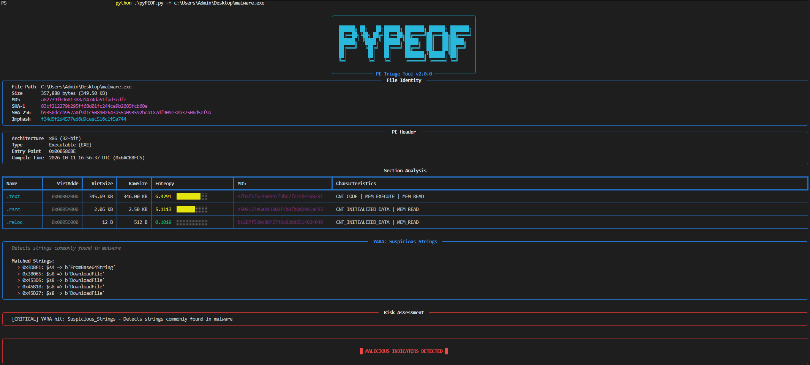

<div align="center">

# 🕵️ pypeof v2.0

**Advanced Static Analysis & PE Triage Tool**

[](https://www.python.org/downloads/)
[](https://opensource.org/licenses/MIT)
[](https://github.com/psf/black)
[](https://github.com/bugourmet/pypeof/issues)
[](https://github.com/bugourmet/pypeof/stargazers)

_Fast, structured, and visually intuitive PE binary triage for SOC analysts and reverse engineers._

</div>

---

## 📑 Table of Contents

- [📖 Overview](#-overview)
- [📸 Screenshots & Output Preview](#-screenshots--output-preview)
- [✨ Core Capabilities](#-core-capabilities)
- [📦 Installation](#-installation)
- [💻 Usage & Examples](#-usage--examples)
- [🏗️ Architecture](#️-architecture)
- [🎯 Heuristics & Rule Coverage](#-heuristics--rule-coverage)
- [🤝 Contributing](#-contributing)
- [📜 License](#-license)

---

## 📖 Overview

**pypeof** (Python PE EOF) is a modular static analysis tool engineered for rapid triage of Windows Portable Executable (PE) files. Originally designed to detect data appended past the authentic end-of-file (overlay/EOF), version 2.0 expands it into a complete command-line triage suite.

The framework pairs structural PE inspection and Shannon entropy scoring with signature-based YARA scanning and terminal rendering, isolating IoCs and anomalous traits quickly .

---

## 📸 Screenshots & Output Preview

```text
+--------------------------------------------------------------------------+
|                        CONSOLE SAMPLE OUTPUT                             |
+--------------------------------------------------------------------------+
```



## ✨ Core Capabilities

```text
[+] Section Metrics & Entropy Analysis
    Calculates Shannon entropy (0.00 to 8.00) across every individual section.
    Flags packers, compressed payloads, and encrypted code segments with visual meters.

[+] Structural Anomaly Detection
    Detects section hollowing indicators (RawSize == 0 with VirtualSize > 0).
    Identifies hazardous permission combinations (MEM_WRITE + MEM_EXECUTE).
    Highlights non-standard section labels and compiler inconsistencies.

[+] Overlay (EOF) Identification & Extraction
    Computes exact physical header boundaries vs. file size on disk.
    Measures overlay entropy and generates hexadecimal and ASCII previews.
    Offers direct payload dumping (--dump-overlay) for sandboxing and reverse engineering.

[+] Compile Timestamp Verification
    Identifies timestamp falsification (epoch nulls, future timestamps, pre-NT values).
    Detects Borland/Delphi legacy signature constants (0x2A425E19).

[+] YARA Rule Scanning Engine
    Integrated rules targeting common packers, dangerous injection APIs, shellcode patterns,
    and embedded executables.
    Full support for user-supplied custom rules (--yara-rules).

[+] Structured JSON Output
    Exports exhaustive analysis metrics directly to JSON (--json) for ingestion into
    SIEM, SOAR, or automated malware pipelines.
```

---

## 📦 Installation

Requires **Python 3.10+**.

### Standard Installation (Package)

```bash
git clone https://github.com/bugourmet/pypeof.git
cd pypeof
pip install .[yara]
```

> Note: `[yara]` installs the native `yara-python` binding. For environments without native compiler toolchains, install standard dependencies without the extra flag.

### Standalone / Portable Execution

```bash
git clone https://github.com/bugourmet/pypeof.git
cd pypeof
pip install -r requirements.txt
python pyPEOF.py --help
```

---

## 💻 Usage & Examples

```text
usage: pypeof [-h] -f PATH [--dump-overlay] [--json FILE] [--yara-rules PATH]
              [--no-yara] [-v]

pypeof - Advanced PE Triage & Static Analysis Tool for Windows Binaries

options:
  -h, --help            Show this help message and exit
  -v, --version         Show program's version number and exit

Target Specification:
  -f PATH, --file PATH  Path to the target PE file (EXE, DLL, SYS) to triage

Extraction & Export Options:
  --dump-overlay        Extract and dump identified EOF overlay data to '<file>.overlay'
  --json FILE           Save full structured triage report in JSON format to specified path

YARA & Detection Rules:
  --yara-rules PATH     Path to a custom YARA rule (.yar) or directory containing rule files
  --no-yara             Disable YARA scanning engine during analysis
```

### Common Commands

```bash
# 1. Standard triage of a target binary
python pyPEOF.py -f sample.exe

# 2. Extract trailing overlay data to disk (creates sample.exe.overlay)
python pyPEOF.py -f sample.exe --dump-overlay

# 3. Export complete analysis report to JSON
python pyPEOF.py -f sample.exe --json report.json

# 4. Apply custom threat hunting YARA signatures
python pyPEOF.py -f sample.exe --yara-rules ./yara_rules/

# 5. Rapid execution without YARA scanner
python pyPEOF.py -f sample.exe --no-yara
```

---

## 🏗️ Architecture

The project maintains strict separation of concerns across dedicated modules:

```text
pypeof/
├── __init__.py           Version definitions and package initialization
├── __main__.py           Module entry point (python -m pypeof)
├── cli.py                CLI argument routing and workflow orchestration
├── models.py             Dataclass models (TriageReport, SectionInfo, OverlayInfo)
├── analyzers.py          Core analysis engine (entropy, sections, timestamps, overlay)
├── yara_scanner.py       Rule compiler and signature matching interface
├── formatter.py          Rich-based terminal renderer and JSON serialization
└── rules/                Built-in detection signatures
    ├── suspicious_pe.yar
    ├── malware_indicators.yar
    └── crypto_signatures.yar
```

---

## 🎯 Heuristics & Rule Coverage

```text
+-----------------------+-------------------------------------------------------+
| Category              | Rule / Check Description                              |
+-----------------------+-------------------------------------------------------+
| Section Integrity     | RawSize = 0 with VirtualSize > 0 (Section Hollowing)  |
| Section Permissions   | Writable + Executable (RWX) code pages               |
| Section Entropy       | Shannon score > 7.0 (Packed / Encrypted code)         |
| Packer Signatures     | UPX, Themida, VMProtect, ASPack, MEW, PECompact      |
| Malicious APIs        | VirtualAllocEx, WriteProcessMemory, QueueUserAPC      |
| Cryptographic Loops   | Byte-level XOR decoding loops, Base64 MZ indicators   |
| Shellcode Patterns    | NOP sleds, TEB/PEB lookups, SEH frame manipulation   |
| Trailing Data         | Out-of-bounds EOF offset calculation & payload preview|
+-----------------------+-------------------------------------------------------+
```

---

## 🤝 Contributing

Contributions, additional YARA signatures, and heuristic checks are welcome.

1. Fork the repository
2. Create your topic branch (`git checkout -b feature/new-heuristic`)
3. Commit your changes (`git commit -m 'feat: add TLS callback detection'`)
4. Push to the branch (`git push origin feature/new-heuristic`)
5. Open a Pull Request

---

## 📜 License

Distributed under the MIT License. See [LICENSE.txt](LICENSE.txt) for details.
